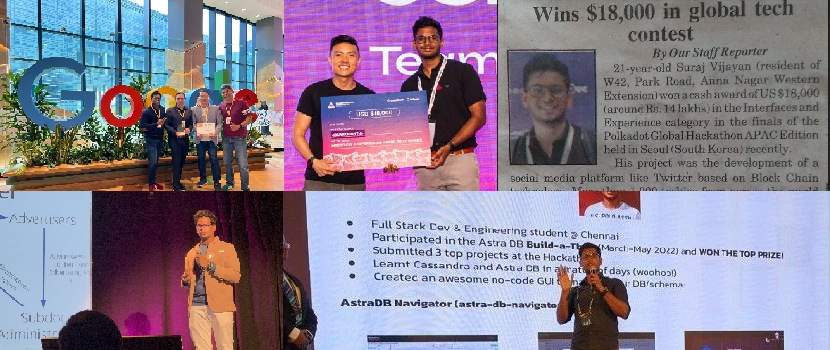

# Hey, I'm Suraj 👋

**Full-stack engineer heading into fintech infrastructure.**

I ship whole products: polished React and Next.js frontends, Node.js backends, mobile apps. Now going deeper into payments, ledgers, Go, Rust and distributed systems.

4x international hackathon winner ($45K+ in prizes, 3 of 4 won solo and pre-AI agents) · Ex founding engineer @ Good Bards (Singapore) · Certified Cassandra developer

**Open to software engineer (founding or product or core) roles in fintech, payments or Web3.** Remote, or happy to relocate. Say hi at [surajvijay67@gmail.com](mailto:surajvijay67@gmail.com).

🧭 **Just shipped: [Ariadne](https://github.com/its-me-sv/ariadne-fintech-atlas)**, a 3D, source-backed atlas of how payments really move across six markets.

        

📑 **Jump to:** **[Building](#-currently-building)** · **[Projects](#-top-projects)** · **[Achievements](#-achievements)** · **[Experience](#-experience)** · **[Certifications](#-certifications)** · **[Stack](#-stack)** · **[Education](#-education)**

## 🔨 Currently building

- **A distributed key-value store, from scratch.** The best way I know to learn how databases really work.
- **Learning Go and Rust.** Picking up systems depth one small build at a time.

## 🚀 Top projects

| Project | What it is | Built with |
|---|---|---|
| **[Ariadne](https://github.com/its-me-sv/ariadne-fintech-atlas)** 🆕 | Spin a globe, step into a 3D city per market and follow one payment from app to settlement. 736 systems, 442 rules, 24 traces, 1,306 sourced claims across India, UK, US, EU, Singapore and China | React, TypeScript, Three.js, React Three Fiber, React Flow, Vite |
| **[Payzer](https://surajvijay.hashnode.dev/everything-about-project-payzer-1)** | Cross-border payments. Postgres triggers for transactional integrity, Redis rate limiting, event-driven SMS via LISTEN/NOTIFY | React Native, Express, PostgreSQL, Redis |
| **[Subdot](https://github.com/its-me-sv/subdot-frontend)** 🥇🥈 | A Twitter-style social platform on Polkadot. Won Seoul, placed 2nd in Paris | Polkadot, React, TypeScript |
| **[Zeyphr](https://github.com/SriranganK/zeyphr-frontend)** 🏅 | Payments project at IOTA Moveathon. I led a 4-person team across smart contracts, backend and POS hardware | IOTA, Move |
| **[Astra DB Navigator](https://github.com/its-me-sv/astra-db-navigator-with-backend)** 🏆 | No-code admin console for AstraDB. A serverless backend keeps credentials out of the browser | React, TypeScript, Netlify Functions, Cassandra |
| **[Pirate Land](https://its-me-sv.github.io/pirate-land/)** | Battleship, but pirates. Solo-built and live on Google Play | React Native, Expo, Zustand, Reanimated |
| **[Aneta](https://github.com/its-me-sv/aneta)** | Workforce management. JWT with server-side session kill, Socket.io chat, a 7-table Cassandra schema | React, Node.js, Express, Cassandra |

## 🏆 Achievements

**$45K+ in prize money across 4 international hackathons.**

| | Event | Where | Result | Prize |
|---|---|---|---|---|
| 🥇 | Polkadot APAC Edition | Seoul · 2023 | **1st place**, Interfaces & Experiences. 1 of 15 finalists from 1,000+ | **$18,000** |
| 🥈 | Polkadot Europe Edition | Paris · 2023 | **2nd of 2,400+**, plus a sponsor award for SDK integration | **$11,000** |
| 🏆 | DataStax AstraDB Build-a-thon | Online · 2022 | **Grand Winner**. 1 of 4 finalists from 2,300+ across 60+ countries | **$9,500** |
| 🏅 | IOTA Moveathon APAC | Singapore · 2025 | **Community Best Project** + 3rd place, Payments & Consumer Apps | **$7,000** |

- ⭐ **Star Achiever Award**, SVCE (2024). The principal's award, one of only two given this decade
- 🧮 **Winner**, Kanitham 2021 national math-modelling symposium
- 🔧 **Merged a fix** into a DataStax repo (2022)
- 📰 **Featured** in Anna Nagar Times and Mogappair Times

## 💼 Experience

### Good Bards · Founding Software Engineer
*Singapore (remote) · Sep 2024 to May 2026*

**Rewrote the whole platform. Wrote 82% of the commits.**

- Pitched and led a full rewrite after month one: 15 product modules, one multi-tenant Next.js app, 180K lines, 90+ pages
- Built the entire app security layer: cookie auth, server-side route protection, CSP, XSS sanitisation
- Solo-built a white-label edition for an enterprise client. It now serves 50+ of their own clients
- Turned one client's chatbot request into a product used across 4 to 5 brands
- Helped get us into Google for Startups Accelerator: AI First (1 of 32) and demoed at GITEX Asia 2025
- Mentored our second engineering hire through PR reviews

`Next.js` `React` `TypeScript` `Tailwind` `Redux` `SWR` `shadcn/ui`

### Destt · Founder
*Chennai · Jun 2024 to Oct 2024*

**A ride-sharing app where drivers keep 100% of the fare.**

- Designed the zero-commission model, the pricing engine and the fare logic
- Built it solo, end to end: rider app, driver matching, Stripe payments, Node.js backend on AstraDB
- Validated with 50+ riders and 10+ drivers, then applied to Y Combinator with a working demo

`React Native` `TypeScript` `Node.js` `Express` `Stripe` `Cassandra`

### Exposys Data Labs · Full-Stack Developer Intern
*Nov 2021 to Dec 2021*

**4 services. 1 month. 1 developer.**

- Shipped [Meet Up](https://github.com/its-me-sv/Meet-Up) solo: a React Native app backed by 3 Node.js services for REST, real-time chat and image uploads

`React Native` `Node.js` `Socket.io` `MongoDB`

### Peace with Smiles · Board Member
*Chennai · Feb 2026 to present*

**Volunteer to board seat in 3 months.**

- Ran Kids-2-Kids: collected clothes from daycare families and gave them to orphaned children
- Building the NGO's new website

## 📜 Certifications

**Professional**
- [Apache Cassandra 3 Developer Associate](https://certification.mettl.com/datastax/applicant/result/download-certificate?key=CQGo2K0NO6kAOPzSy2ILvw%3D%3D) · DataStax
- [GitHub Actions (GH-200)](https://learn.microsoft.com/api/credentials/share/en-us/SurajVijayan-0306/B6A3F0CDF18D674?sharingId=365633A4B25DCDFD) · Microsoft
- [Redis for Startups (with JavaScript)](https://university.redis.io/certificate/kuzlf2lpgttvc8) · Redis
- [Hashgraph Developer](https://certs.hashgraphdev.com/1219d8b6-7aa5-40cb-9f97-f5a923b798f6.pdf) · Hedera & Hashgraph

**HackerRank**
- [Node.js](https://www.hackerrank.com/certificates/de215f896713) · [REST API](https://www.hackerrank.com/certificates/c77f4d2476bd) · [Problem Solving](https://www.hackerrank.com/certificates/b58f2dd9c23a) · [JavaScript](https://www.hackerrank.com/certificates/a8df11daf5d3) · [React](https://www.hackerrank.com/certificates/e47e5b043717) · [SQL](https://www.hackerrank.com/certificates/cf0e87f41c32) · [Python](https://www.hackerrank.com/certificates/6cc3fe2ce333)

**freeCodeCamp**
- [APIs and Microservices](https://www.freecodecamp.org/certification/sura_vijay_115_py/apis-and-microservices) · [Quality Assurance](https://www.freecodecamp.org/certification/sura_vijay_115_py/quality-assurance-v7) · [JavaScript Algorithms and Data Structures](https://www.freecodecamp.org/certification/sura_vijay_115_py/javascript-algorithms-and-data-structures) · [Front End Libraries](https://www.freecodecamp.org/certification/sura_vijay_115_py/front-end-libraries) · [Scientific Computing with Python](https://www.freecodecamp.org/certification/sura_vijay_115_py/scientific-computing-with-python-v7) · [Responsive Web Design](https://www.freecodecamp.org/certification/sura_vijay_115_py/responsive-web-design) · [Legacy Front End](https://www.freecodecamp.org/certification/sura_vijay_115_py/legacy-front-end)

**Coursera**
- [Problem Solving Using Computational Thinking](https://coursera.org/share/035a822fb286a7a6875f7d269746b2f3) · University of Michigan

## 🛠️ Stack

**Languages**

       

**Frontend & mobile**

        

**Backend**

   

**Databases**

   

**Cloud, DevOps & tools**

        

## 🎓 Education

- **B.Tech, Artificial Intelligence & Data Science** · Sri Venkateswara College of Engineering, Chennai · 2024 · CGPA 8.7
- **Higher Secondary (PCM + Computer Science)** · SBOA School & Junior College, Chennai · 2020
